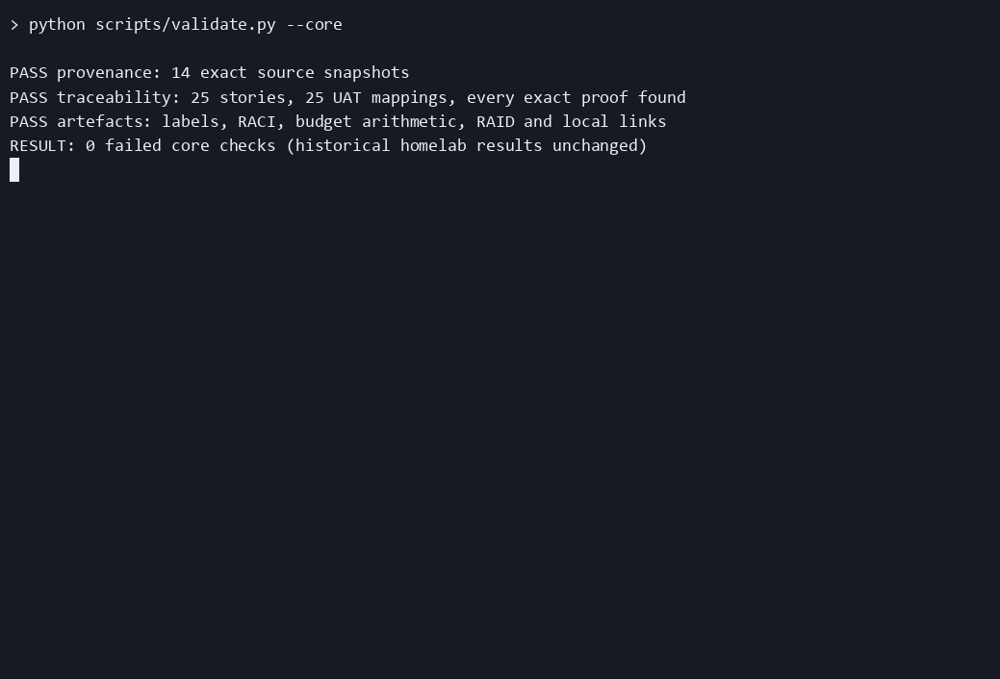
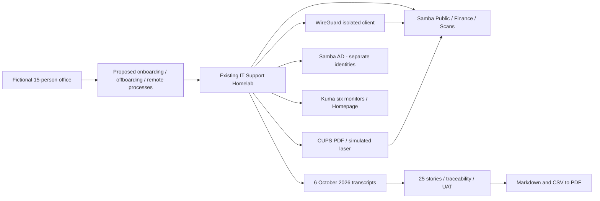
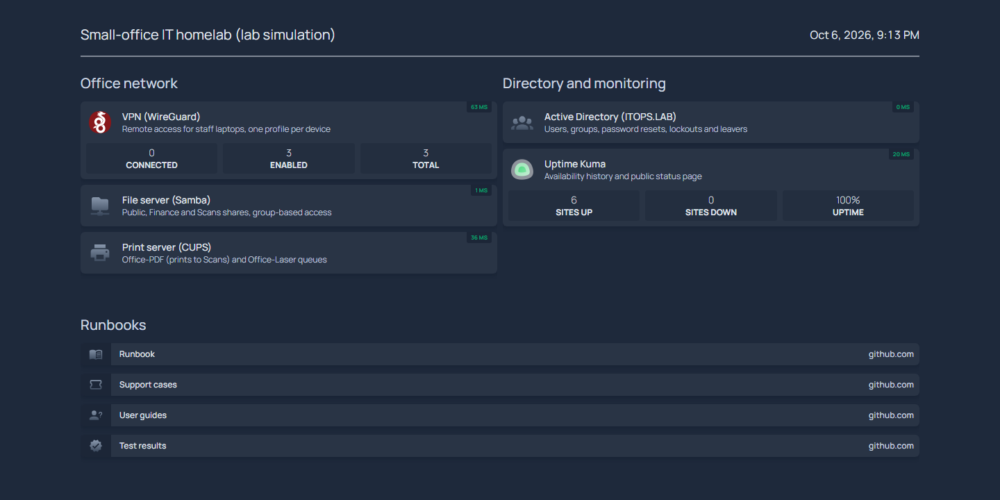
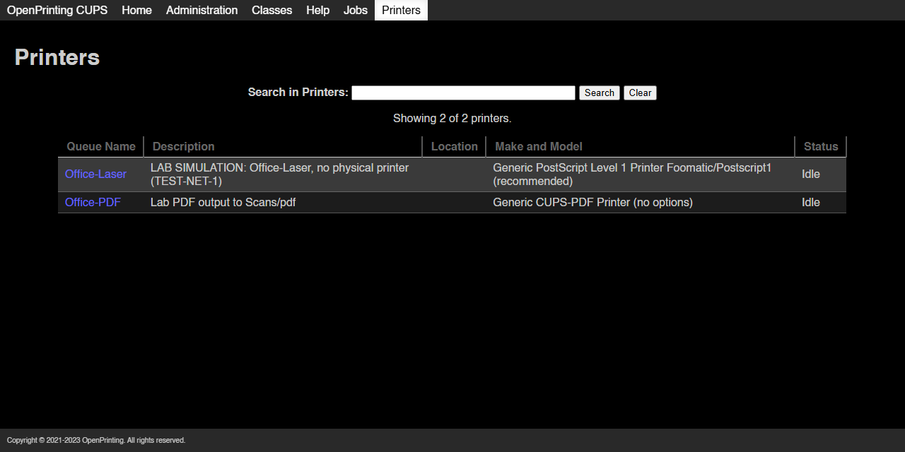

An evidence-backed IT rollout case study showing Project Coordinator, PMO Analyst and Business Analyst skills for a fictional 15-person office.



[](https://github.com/iamnajib71/it-rollout-delivery-pack/actions/workflows/ci.yml)  

## What it shows recruiters
- **Project Coordinator:** charter, WBS, milestones, communications, cutover and handover with owners.
- **PMO Analyst:** RACI, cost estimate, RAID, worked change control and three fictional weekly RAG reports.
- **Business Analyst:** six process maps, 25 Given/When/Then stories, BRD and qualified requirements traceability.

## Start here - two minutes
| Review | Artefact |
|---|---|
| Scope and people | [Charter](initiation/charter.md), [stakeholders](initiation/stakeholders.csv), [RACI](initiation/raci-guide.md) |
| Requirements and processes | [BRD](business-analysis/brd.md); [onboarding](business-analysis/process-onboarding.md), [offboarding](business-analysis/process-offboarding.md), [remote access](business-analysis/process-remote-access.md) |
| Stories and proof | [Jira backlog](backlog.csv), [import guide](business-analysis/jira-import.md), [traceability](business-analysis/traceability.csv) |
| Delivery baseline | [WBS](planning/wbs.csv), [schedule](planning/schedule.md), [budget](planning/budget.md), [communications](planning/communications.csv) |
| Control | [RAID](control/raid.csv), [change log](control/change-log.csv), [worked CR](control/change-request-001.md), status [1](control/status-week-01.md) / [2](control/status-week-02.md) / [3](control/status-week-03.md) |
| Acceptance and transition | [UAT plan](testing/uat-plan.md), [cases](testing/uat-cases.csv), [results](testing/uat-results.md), [go-live](testing/go-live-checklist.md), [cutover](testing/cutover-plan.md), [rollback](testing/rollback-plan.md) |
| Closure and export | [Lessons](closure/lessons-learned.md), [handover](closure/handover.md), [PDF pack](pack/IT-Rollout-Delivery-Pack.pdf) |

## Architecture and evidence

[Original homelab](https://github.com/iamnajib71/it-support-homelab). [Manifest](evidence/manifest.json) pins the inspected revision and SHA-256 hashes. Snapshots preserve historical output; this pack does not start Docker.

## Screenshots




## Quick start - Windows
**Runs locally.** The demo records pack validation, PDF export and evidence review, not a new homelab run. Requires Git and Python 3.11+ on PATH. No Docker, Jira account or secrets needed.

```powershell
git clone https://github.com/iamnajib71/it-rollout-delivery-pack.git
cd it-rollout-delivery-pack
python -m venv .venv
.\.venv\Scripts\python.exe -m pip install -r requirements.txt
.\.venv\Scripts\python.exe scripts/validate.py
.\.venv\Scripts\python.exe scripts/build_pdf.py
.\.venv\Scripts\python.exe scripts/record_demo.py
.\.venv\Scripts\python.exe scripts/build_site.py
.\.venv\Scripts\python.exe scripts/show_evidence.py --story US-19
```
Open the PDF and GIF using the links above. The PDF command reads all delivery Markdown and CSV sources. Mermaid source is preserved legibly in the PDF; GitHub renders it graphically. The recorder saves actual output in asciicast v2 `docs/demo.cast`; the published GIF uses asciinema's **agg** renderer. With `--agg PATH_TO_AGG`, regeneration uses agg; the default portable Pillow renderer keeps the quick start self-contained. Recording takes about 35 seconds. [Verification](docs/verification.md).

## Results and evidence
| Real historical result | Value | Source |
|---|---|---|
| Homelab checks, 6 Oct 21:12 Sydney | 0 failed checks | [Transcript](evidence/homelab/docs/evidence/homelab-check-20261006-211239-566.txt) |
| AD tasks, 6 Oct 15:55 Sydney | 0 failed checks | [Transcript](evidence/homelab/docs/evidence/ad-tasks-20261006-155516-705.txt) |
| Injected faults repaired | 3 of 3 | [Transcript](evidence/homelab/docs/evidence/support-cases-20261006-155525.txt) |
| Monitors at recorded check | 6, all UP | Homelab transcript above; point in time, not SLA |
| Story-to-evidence mappings | 25 | [RTM](business-analysis/traceability.csv); compound checks reused, not 25 independent runs |

## Project structure
`initiation/` scope/roles; `business-analysis/` BRD/processes/RTM; `planning/` baseline; `control/` logs/reports; `testing/` UAT/transition; `closure/` handover; `evidence/` source snapshots; `scripts/` build/validate/demo; `pack/` PDF; `docs/` media/verification.

## Honest limits
Office, people, approvals, budget, schedule and reports are fictional. Evidence dates are real. This is retrospective lab acceptance, not business-user UAT or production deployment. No public VPN, MFA, Windows domain join, AD-integrated shares, physical laser, scheduled backup, proven restore or 15-user load test. Epic Link stays blank until real Jira keys exist. Real-office go-live remains on hold. Screenshots are historical source captures. Social preview upload is a manual Settings step for Nazmul.

Built by Nazmul Hassan: [LinkedIn](https://www.linkedin.com/in/iamnajib71) | [GitHub](https://github.com/iamnajib71)
