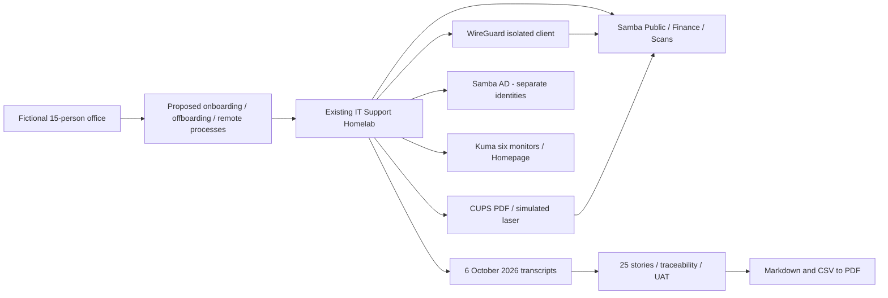

# IT Rollout Delivery Pack

I built a fictional office rollout case study in a real Jira Cloud site, connecting requirements, delivery controls and a status report to traceable lab evidence.


[](https://github.com/iamnajib71/it-rollout-delivery-pack/actions/workflows/ci.yml) · [MIT licence](LICENSE)

## At a glance

| Area | Evidence-backed summary |
| --- | --- |
| **The problem** | A fictional 15-person office relies on local accounts, ad hoc file copies and informal remote-access requests; staff and support lose time to unclear access and ownership. [The charter](initiation/charter.md) labels this as an assumed scenario. |
| **What I built** | I configured a real Jira Scrum project, workflow, custom fields, automation, filters, sprint and dashboard; imported the delivery pack; and built an Excel status report from the live export. |
| **Results** | [43 Jira issues: 5 epics, 25 stories, 12 RAID tasks and 1 change request](jira/issues.csv); [2 enabled automation rules](jira/automation-rules.json). [A verified rerun kept the same issue keys](jira/verification.md). The fictional case study has no business-user UAT or production completion claim. |
| **Skills shown** | Jira Administration, Jira Cloud REST API, Scrum, JQL, Jira Automation, dashboards, Excel reporting, requirements gathering, acceptance criteria, requirements traceability, UAT, RAID, change control and project coordination. |
| **Relevant roles** | Jira Administrator, Tools and Reporting Analyst, Project Coordinator, Business Analyst. |
| **Try it / evidence** | [Jira board capture](jira/screenshots/board.png) · [Dashboard capture](jira/screenshots/dashboard.png) · [Excel report](jira/status-report.xlsx) · [Run in Jira](#run-in-jira) · [Live case study](https://iamnajib71.github.io/it-rollout-delivery-pack/) |

## What I did, step by step

1. Defined the fictional office, scope, exclusions and decision owners in the [charter](initiation/charter.md).
2. Inspected the existing lab rather than claiming stakeholder interviews; wrote the [BRD](business-analysis/brd.md), process maps and acceptance stories.
3. Prepared the [work breakdown](planning/wbs.csv), schedule, budget, RACI and communications baseline.
4. Worked through a simulated change request and status reports, keeping assumptions separate from measured technical results.
5. Mapped each story to specific historical checks and an explicit limit, then planned UAT, cutover, rollback and handover.
6. Imported the pack into a real Jira Cloud Scrum project with stable source IDs, requirement fields, epic parents and story estimates; configured a dedicated To Do → In Progress → In UAT → Done workflow.
7. Enabled two project automation rules, started a four-story pilot sprint, and tested UAT assignment with explicitly labelled fictional administration exercises. Captured the board, dashboard and automation settings.
8. Re-ran the importer, verified the live export against all source stories, and built an Excel report showing progress by epic, UAT status and open risks. [Jira verification](jira/verification.md) · [Earlier pack verification](docs/verification.md).

## Problems I hit and how I solved them

- **Windows checkout conversion could change evidence bytes:** preserved evidence line endings and binary exports with Git attributes so the manifest still validates after cloning. [Verification record](docs/verification.md) · [fixing commit](https://github.com/iamnajib71/it-rollout-delivery-pack/commit/db1bb48).
- **A component check does not prove an entire office rollout:** qualified the story mappings and left real-office go-live on hold for untested requirements. [Lessons learned](closure/lessons-learned.md) · [acceptance limits](business-analysis/brd.md).
- **The configured site initially exposed Confluence but returned Jira API 404:** paused mutations until Jira access was enabled, then verified administrator access. [Run record](jira/verification.md).
- **Custom fields were absent from the create screen, and Jira capped field-list pages:** added fields to dedicated project screens and paginated administrator field discovery. Verification caught the retry problem; unused duplicates were moved to recoverable trash, and a corrected rerun preserved all issue keys. [Importer](scripts/jira_import.py).

## Run in Jira

**Fictional case study run in a real Jira site.** [Project](https://iamnajib.atlassian.net/browse/ITROLL) · [Scrum board](https://iamnajib.atlassian.net/jira/software/c/projects/ITROLL/boards/2) · [Dashboard](https://iamnajib.atlassian.net/jira/dashboards/10001). Jira links require site access; the committed captures and exports can be reviewed without an account.

The live export contains 25 stories: 23 To Do, 1 In Progress, 1 In UAT and 0 Done. The two moved stories test Jira administration; they are not new lab runs or business acceptance. Four risk records remain open in Jira; their original RAID states are retained in descriptions and labels.

Use Python 3.11+ and a Jira administrator account. Keep exactly `JIRA_BASE_URL`, `JIRA_EMAIL` and `JIRA_API_TOKEN` in the ignored `.env`. A hostname without a scheme is normalised to HTTPS. Never paste credentials into commands or commit them.

```powershell
python scripts/jira_import.py --plan        # source manifest; no network
python scripts/jira_import.py --probe       # check authentication/permissions
python scripts/jira_import.py               # create or reuse ITROLL and its source-marked issues
python scripts/jira_configure.py            # project automation and dashboard gadget creation
python scripts/jira_import.py --export-only # refresh actual CSV / JSON evidence
python scripts/verify_jira.py               # verify saved evidence against source artefacts
```

Preserve `jira/state.json`. The importer verifies project and source ownership, resumes from saved Jira keys and uses source labels for recovery. It creates missing issues; it does not overwrite later human edits or reset progress. Run one importer at a time. After an uncertain network response, inspect the site and allow search indexing to catch up before retrying. [UI configuration and manual steps](jira/manual-steps.md) cover board mapping, gadget preferences, review due dates and capture refreshes. No plan upgrade was made.

[CSV export](jira/issues.csv) · [JQL filters](jira/filters.json) · [Automation API export](jira/automation-rules.json) · [Excel report](jira/status-report.xlsx) · [Report preview](jira/status-report-preview.png) · [Detailed verification](jira/verification.md). The report builder uses the bundled spreadsheet runtime; [rebuild instructions](jira/manual-steps.md) document that local dependency.

## Start here
| Review | Artefact |
|---|---|
| Scope and people | [Charter](initiation/charter.md), [stakeholders](initiation/stakeholders.csv), [RACI](initiation/raci-guide.md) |
| Requirements and processes | [BRD](business-analysis/brd.md); [onboarding](business-analysis/process-onboarding.md), [offboarding](business-analysis/process-offboarding.md), [remote access](business-analysis/process-remote-access.md) |
| Stories and proof | [Jira backlog](backlog.csv), [import guide](business-analysis/jira-import.md), [traceability](business-analysis/traceability.csv) |
| Delivery baseline | [WBS](planning/wbs.csv), [schedule](planning/schedule.md), [budget](planning/budget.md), [communications](planning/communications.csv) |
| Control | [RAID](control/raid.csv), [change log](control/change-log.csv), [worked CR](control/change-request-001.md), status [1](control/status-week-01.md) / [2](control/status-week-02.md) / [3](control/status-week-03.md) |
| Acceptance and transition | [UAT plan](testing/uat-plan.md), [cases](testing/uat-cases.csv), [results](testing/uat-results.md), [go-live](testing/go-live-checklist.md), [cutover](testing/cutover-plan.md), [rollback](testing/rollback-plan.md) |
| Closure and export | [Lessons](closure/lessons-learned.md), [handover](closure/handover.md), [PDF pack](pack/IT-Rollout-Delivery-Pack.pdf) |

## Architecture and evidence

[Original homelab](https://github.com/iamnajib71/it-support-homelab). [Manifest](evidence/manifest.json) pins the inspected revision and SHA-256 hashes. Snapshots preserve historical output; this pack does not start Docker.

## Screenshots


## Quick start - Windows
**Runs locally.** The demo records pack validation, PDF export and evidence review, not a new homelab run. Requires Git and Python 3.11+ on PATH. No Docker, Jira account or secrets needed.

```powershell
git clone https://github.com/iamnajib71/it-rollout-delivery-pack.git
cd it-rollout-delivery-pack
python -m venv .venv
.\.venv\Scripts\python.exe -m pip install -r requirements.txt
.\.venv\Scripts\python.exe scripts/validate.py
.\.venv\Scripts\python.exe scripts/build_pdf.py
.\.venv\Scripts\python.exe scripts/record_demo.py
.\.venv\Scripts\python.exe scripts/build_site.py
.\.venv\Scripts\python.exe scripts/show_evidence.py --story US-19
```
Open the PDF and GIF using the links above. The PDF command reads all delivery Markdown and CSV sources. Mermaid source is preserved legibly in the PDF; GitHub renders it graphically. The recorder saves actual output in asciicast v2 `docs/demo.cast`; the published GIF uses asciinema's **agg** renderer. With `--agg PATH_TO_AGG`, regeneration uses agg; the default portable Pillow renderer keeps the quick start self-contained. [Verification](docs/verification.md).

## Results and evidence
| Real historical result | Value | Source |
|---|---|---|
| Homelab checks, 6 Oct 21:12 Sydney | 0 failed checks | [Transcript](evidence/homelab/docs/evidence/homelab-check-20261006-211239-566.txt) |
| AD tasks, 6 Oct 15:55 Sydney | 0 failed checks | [Transcript](evidence/homelab/docs/evidence/ad-tasks-20261006-155516-705.txt) |
| Injected faults repaired | 3 of 3 | [Transcript](evidence/homelab/docs/evidence/support-cases-20261006-155525.txt) |
| Monitors at recorded check | 6, all UP | Homelab transcript above; point in time, not SLA |
| Story-to-evidence mappings | 25 | [RTM](business-analysis/traceability.csv); compound checks reused, not 25 independent runs |

## Project structure
`initiation/` scope/roles; `business-analysis/` BRD/processes/RTM; `planning/` baseline; `control/` logs/reports; `testing/` UAT/transition; `closure/` handover; `evidence/` source snapshots; `scripts/` build/validate/demo; `pack/` PDF; `docs/` media/verification.

## Honest limits
Office, people, approvals, budget and rollout schedule are fictional. Jira configuration, issue keys, API exports and Jira screenshots are real; the pilot sprint and status transitions are case-study administration exercises. Historical lab acceptance remains separate from business-user UAT and production deployment. No public VPN, MFA, Windows domain join, AD-integrated shares, physical laser, scheduled backup, proven restore or 15-user load test. The portable source CSV retains blank Epic Link; actual Jira parent keys are in the live export. Real-office go-live remains on hold. Lab screenshots remain historical. The new sprint has no delivery history or completed work. Review dates need human decisions before the overdue-risk rule can flag genuine overdue reviews. Social preview upload is a manual Settings step for Nazmul.

## Built by Nazmul Hassan

[LinkedIn](https://www.linkedin.com/in/iamnajib71) · [GitHub](https://github.com/iamnajib71)
