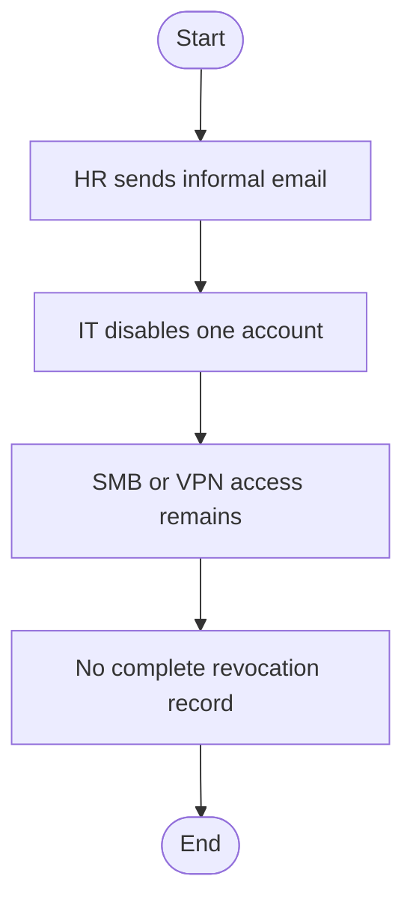
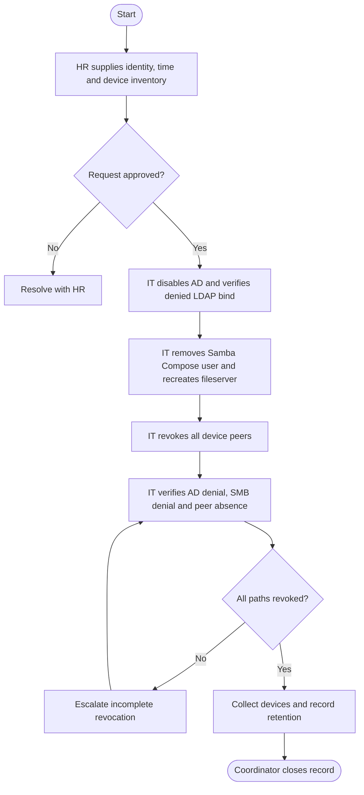

# Offboarding process map

> Fictional office and people. Planning and approvals are case-study simulations; technical results are historical lab evidence only.

## Current state - assumed fictional baseline

## Future state - proposed controlled process
BPMN-style flowchart: start/end events, task rectangles and decision gateways. This is not a BPMN 2.0 interchange file. Tasks identify their owner.

## Evidence and improvement measure
AD disable and peer deletion are proven separately. A complete leaver workflow including persistent SMB removal was not run.
Proposed measure: request-to-completion time and rework rate across a 15-person pilot. No business KPI values were collected.
