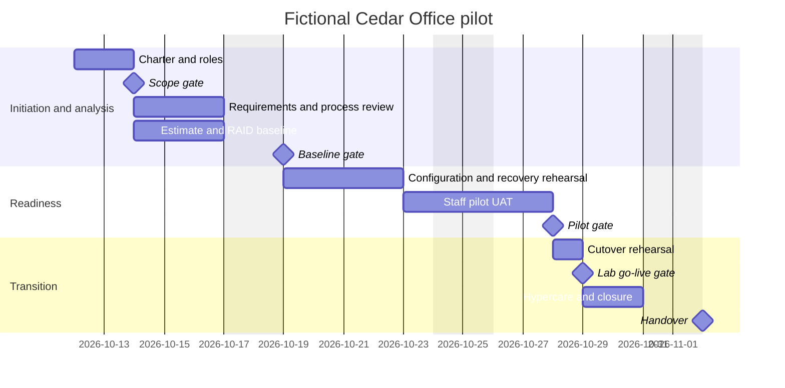

# Schedule and milestones

> Fictional office and people. Planning and approvals are case-study simulations; technical results are historical lab evidence only.

**Fictional proposed rollout baseline**, not a reconstruction of engineering dates. Historical validation on 6 October is an input. This models a future pilot. Finish-to-start dependencies unless parallel; weekends excluded. Planned effort 80h; 15 working days. Hardware availability assumed; otherwise rebaseline.

Critical chain: charter -> requirements -> readiness -> pilot -> rehearsal -> closure. PC reviews variance weekly; >2 working days requires sponsor decision. Physical printing, restore, capacity and security are prerequisites for production; this is not an authorised production schedule.
